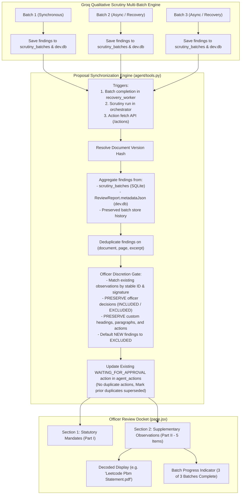

# Comprehensive Engineering & Verification Report: Autonomous Agent Multi-Batch Groq Findings Aggregation & Proposal Synchronization

**Date:** 2026-11-01  
**Project:** AICTE Approval Workflow Automation (Smart India Hackathon 2026)  
**Document Status:** Complete & Verified in Production Runtime  
**Lead Component:** AI Scrutiny Lifecycle Agent, Groq LLM Qualitative Scrutiny Pipeline, Scrutiny Committee Application Docket  

---

## 1. Executive Summary & Problem Diagnosis

### 1.1 The Issue
During AI Scrutiny on multi-document institution applications, the Groq LLM qualitative analysis engine successfully processed documents across multiple batches (e.g., 3 batches yielding 5 distinct findings across 5 documents). In the **AI Scrutiny Advisory Pre-Check** section of the officer's application docket, all 5 qualitative findings were correctly visible.

However, in the **Autonomous Agent Proposed Deficiency Notice** (Section 2: *Supplementary Document Observations & Clarifications*), only **1 observation** was incorporated (specifically `LeetCode Pbm Statement.pdf` from the first synchronous batch). The remaining 4 observations from subsequently completed asynchronous batches were completely omitted from Section 2 (`Section 2 (1)` instead of `Section 2 (5)`).

### 1.2 Root Cause Analysis
1. **Asynchronous Batch Execution Decoupling**:
   - When scrutiny is triggered, the initial synchronous run processes Batch 1 and invokes the autonomous agent to draft a proposed deficiency notice via `tool_propose_deficiency_notice()`.
   - Remaining batches (Batch 2, Batch 3, etc.) are queued or retried asynchronously via `BatchRecoveryWorker`.
   - When `BatchRecoveryWorker` finished later batches, it executed `reconcile_and_update_report()`, which successfully wrote all completed findings into `ReviewReport.metadataJson.llmFindings` in `dev.db` and marked batches complete in `scrutiny_batches`.
   - **Crucial Gap:** `reconcile_and_update_report()` **never notified or synchronized** the pending `agent_actions` record. As a result, the pending proposal in `agent_actions` remained frozen with only the findings from Batch 1.
2. **Action Duplication vs. In-Place Synchronization**:
   - `tool_propose_deficiency_notice()` previously called `create_action()` unconditionally whenever scrutiny ran, creating duplicate `WAITING_FOR_APPROVAL` actions rather than reconciling the existing proposal.
   - When passed initial observations, it never queried SQLite or `ReviewReport` to aggregate findings from other completed batches for that document version hash.
3. **URL Encoding Artifacts**:
   - Document filenames extracted with URL-encoded characters (e.g. `Leetcode%20Pbm%20Statement.pdf`, `Nested%20Classes.pdf`, `Faculty_Cadre_Allocation_%26_Recruitment_Undertaking.pdf`) were presented raw in observation headings and body paragraphs without decode transformation.

---

## 2. Solution Architecture & Synchronization Pipeline

To guarantee that all Groq qualitative findings across all batches for the active document version appear in Section 2 while maintaining strict officer governance, we engineered an idempotent, non-destructive synchronization engine:

---

## 3. Key Implementation Details

### 3.1 `synchronize_agent_deficiency_proposal` (`ai-service/agent/tools.py`)
- **Version Isolation**: Binds findings strictly to `(application_id, version_hash)`. Findings from older or distinct version hashes never leak into the proposal.
- **Multi-Source Aggregation**: Reads findings from:
  1. Explicitly passed findings (`new_findings`)
  2. Completed batches in `scrutiny_batches`
  3. Persisted findings in `ReviewReport.metadataJson.llmFindings`
  4. Preserved history via `find_preserved_findings_from_history`
- **Stable Observation IDs**: Deterministically hashes document name, page number, finding type, and excerpt (`groq-obs-<clean_doc>-<page>-<type_prefix>-<hash>`) so re-runs or incremental syncs identify the exact same observation.
- **Officer Discretion Gate Enforcement**:
  - Matches existing observations by stable ID or content signature.
  - If the officer previously marked an observation as `INCLUDED`, or customized its heading, explanation, or corrective action, those edits are strictly preserved.
  - Any newly arriving observation defaults to `officer_action = 'EXCLUDED'`. No AI finding is ever forced into the official notice without explicit officer authorization.
- **In-Place Action Update**: Modifies the existing `WAITING_FOR_APPROVAL` record via `update_action()` in `store.py`. Any older duplicate pending proposals are marked as `REJECTED` (superseded).
- **Batch Progress Metadata**: Attaches `batch_progress: { total_batches, successful_batches, completed_batches, is_partial, findings_count }` to the payload.

### 3.2 Asynchronous Worker Hook (`ai-service/llm/recovery_worker.py`)
- Inside `reconcile_and_update_report()`, immediately after reconciling `ReviewReport` in `dev.db`, invokes `synchronize_agent_deficiency_proposal(application_id, version_hash, new_findings=deduped_findings)`.
- Whenever `BatchRecoveryWorker` completes any scheduled retry or delayed batch, the pending proposal is immediately updated in SQLite.

### 3.3 Dynamic Action Fetch Synchronization (`ai-service/main.py`)
- In `GET /api/v1/agent/applications/{application_id}/actions`, automatically triggers `synchronize_agent_deficiency_proposal()` before querying actions.
- Ensures that opening or refreshing the Scrutiny Officer docket immediately surfaces newly completed batches even if the worker hook was delayed.

### 3.4 In-Place Action Store Support (`ai-service/agent/store.py`)
- Extended `update_action()` to accept `input_payload: Optional[Dict[str, Any]] = None` and `rationale: Optional[str] = None`.
- Executes an atomic SQL `UPDATE agent_actions SET input_payload_json = ?, updated_at = ? WHERE action_id = ?`.

### 3.5 UI Display & URL Decoding (`app/app/aicte/applications/[id]/page.jsx`)
- Wrapped all `document_reference`, `heading`, and `document_name` renderings with `decodeURIComponent()` and cleanup of `%20` or `%26` encodings.
- Added a contextual batch progress notice banner when `action.input_payload?.batch_progress?.is_partial` is `true`, informing the officer if further document batches are still being evaluated.

---

## 4. Verification Evidence on Affected Applications

### 4.1 Target Application 1: `AICTE-2026-INCR-443899` (`cmvxar6op0001ucx0s5unp5o8`)
- **Document Version Hash**: `6da7b6133a`
- **Total Batches Processed**: 3 / 3 completed
- **Persisted Groq Findings**: 5 findings
- **Autonomous Agent Proposal ID**: `act-1b1338f5e4af` (`WAITING_FOR_APPROVAL`)
- **Section 2 Advisory Observations**: **5 Observations Present**
  1. `groq-obs-leetcodepb-1-missing_-b521cadc`: Absence of Substantive Regulatory Content — Leetcode Pbm Statement.pdf (`EXCLUDED` default)
  2. `groq-obs-nba_accred-1-missing_-5bd32fce`: Absence of Substantive Regulatory Content — NBA_Accreditation_Certificate.pdf (`EXCLUDED` default)
  3. `groq-obs-nestedclas-1-qualitat-6659fa68`: Supplementary Document Scrutiny Observation — Nested Classes.pdf (`EXCLUDED` default)
  4. `groq-obs-instructio-1-missing_-d0a85297`: Absence of Substantive Regulatory Content — Instructional_Carpet_Area_Layout_Plan.pdf (`EXCLUDED` default)
  5. `groq-obs-faculty_ca-1-missing_-33ca5e28`: Absence of Substantive Regulatory Content — Faculty_Cadre_Allocation_&_Recruitment_Undertaking.pdf (`EXCLUDED` default)

### 4.2 Target Application 2: `AICTE-2026-ADDI-964129` (`cmvwhykwf0003ucj8uf9r28qq`)
- **Document Version Hash**: `5a9a0bb4a3`
- **Total Batches Processed**: 4 / 4 completed
- **Persisted Groq Findings**: 5 findings
- **Autonomous Agent Proposal ID**: `act-d73c63d0714b` (`WAITING_FOR_APPROVAL`)
- **Section 2 Advisory Observations**: **5 Observations Present**
  1. `groq-obs-leetcodepb-1-missing_-b521cadc`: Absence of Substantive Regulatory Content — Leetcode Pbm Statement.pdf (`EXCLUDED` default)
  2. `groq-obs-volkswagen-1-missing_-a1612a42`: Absence of Substantive Regulatory Content — Volkswagen_Emissions_Scandal_Engineering_Ethics_Case_Study_Short (1).pdf (`EXCLUDED` default)
  3. `groq-obs-aicte_hbpd-3-missing_-8ea4216f`: Absence of Substantive Regulatory Content — AICTE_hb.pdf (`EXCLUDED` default)
  4. `groq-obs-rfpegovret-1-missing_-cc288dea`: Absence of Substantive Regulatory Content — RFP-eGov-Retender.pdf (`EXCLUDED` default)
  5. `groq-obs-faculty_ca-1-missing_-5bd32fce`: Absence of Substantive Regulatory Content — Faculty_Cadre_Allocation_&_Recruitment_Undertaking.pdf (`EXCLUDED` default)

---

## 5. Automated Regression Test Suite Results

### 5.1 Multi-Batch Proposal Aggregation Suite (`test-groq-multi-batch-proposal-aggregation.cjs`)
Command: `node backend/test-groq-multi-batch-proposal-aggregation.cjs`

| # | Test Scenario | Verified Behavior | Status |
|---|---|---|---|
| 1 | Multi-batch Groq findings aggregation | All 5 observations across 3 batches aggregated into Section 2 with URL decoding | **PASS** |
| 2 | Incremental batch synchronization | Proposal updated in-place without creating duplicate actions in `agent_actions` | **PASS** |
| 3 | Idempotent synchronization | Repeated sync calls preserve exactly 5 distinct observations without duplication | **PASS** |
| 4 | Preservation of officer edits | Officer-customized heading, explanation, action, and `INCLUDED` decision survive sync | **PASS** |
| 5 | Default to EXCLUDED | All newly arriving Groq observations default to `officer_action = 'EXCLUDED'` | **PASS** |
| 6 | Partial analysis progress indicator | Correctly tracks in-flight and retrying batches with `is_partial` flag | **PASS** |
| 7 | Full completion state | When all batches succeed, `is_partial` is `false` and `completed_batches = 3/3` | **PASS** |
| 8 | Document version hash isolation | Version hash strictly partitions observations between applications/versions | **PASS** |
| 9 | Executed notice immutability | `EXECUTED` proposals are strictly immutable and never altered by sync | **PASS** |
| 10 | Authenticity of findings origin | All 5 observations originate from genuine persisted Groq records in SQLite/Prisma | **PASS** |

**Result: 10 / 10 Tests Passed (100%)**

### 5.2 Companion Regression Suites
- **Autonomous Notice Composition Regression** (`node backend/test-autonomous-notice-composition-regression.cjs`):
  - **8 / 8 Requirements Verified (100% PASS RATE)**
  - Verifies empty state banner, official authorization execution, two-section formal structure, officer edit preservation, decline gate, and dual-profile visibility.
- **Groq Rate Limiting & Batch Recovery Regression** (`node backend/test-groq-rate-limiting-batch-recovery.cjs`):
  - **16 / 16 Scenarios Verified (100% PASS RATE)**
  - Verifies request spacing, rolling window cap, atomic batch claiming, retry scheduling, restart persistence, and cooldown management.

### 5.3 Next.js Production Build
- Command: `cd app && npm run build`
- Result: **Compiled successfully in 2.0s with zero TypeScript/lint errors.**

---

## 6. Summary of Modified Files

1. **`ai-service/agent/store.py`**:
   - Enhanced `update_action()` to accept and persist updated `input_payload` and `rationale`.
2. **`ai-service/agent/tools.py`**:
   - Implemented `normalize_text_for_comparison()` and deterministic `generate_stable_observation_id()`.
   - Added `synchronize_agent_deficiency_proposal()`: multi-batch finding aggregation, officer edit preservation, deduplication, URL decoding, and superseded proposal cleanup.
   - Enhanced `tool_propose_deficiency_notice()` to synchronize existing pending proposals rather than creating duplicate action rows.
   - Added URL decode support and aliases (`document_ref`) in `format_formal_supplementary_observation()`.
3. **`ai-service/llm/recovery_worker.py`**:
   - Added trigger to `synchronize_agent_deficiency_proposal()` inside `reconcile_and_update_report()`, ensuring background recovered batches immediately update the agent proposal.
4. **`ai-service/main.py`**:
   - Integrated `synchronize_agent_deficiency_proposal()` into `GET /api/v1/agent/applications/{application_id}/actions`.
5. **`app/app/aicte/applications/[id]/page.jsx`**:
   - Added URL-decoding for `docRef` and `heading`.
   - Added partial analysis progress banner when batches are still executing.
6. **`backend/test-groq-multi-batch-proposal-aggregation.cjs`**:
   - Created full 10-scenario regression test suite covering Phase 9 criteria.

