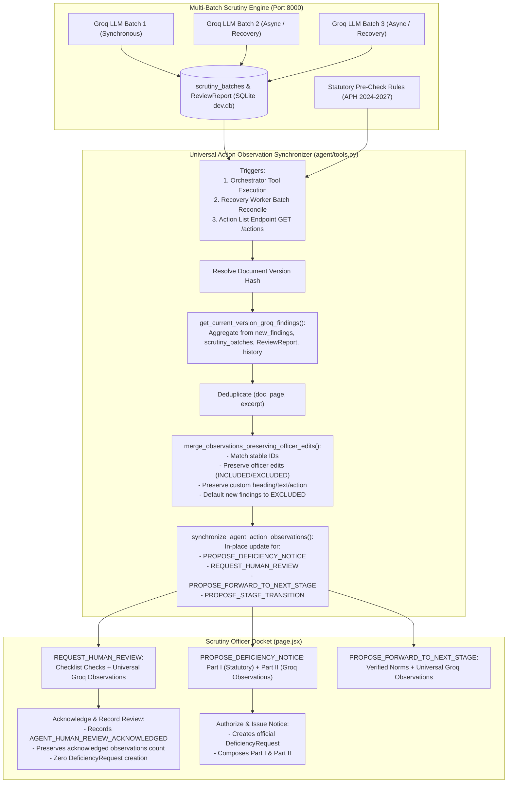

# Comprehensive Engineering & Regulatory Report: Universal Groq Scrutiny Findings Integration Across ALL Autonomous Agent Action Types

**Date:** November 1, 2026  
**Project:** AICTE Approval Workflow Automation Platform (Smart India Hackathon 2026, Problem Statement 26262)  
**Governing Standard:** AICTE Approval Process Handbook (APH 2024-25 to 2026-27)  
**System Status:** FULLY OPERATIONAL & REGRESSION-VERIFIED (100% Pass Rate across 4 Regression Suites)  
**Target Applications Tested:**
- `AICTE-2026-CHAN-641036` (ID: `cmvxcek02000luc40ihve4ohz`) — *Change in the Name of the Institution*
- `AICTE-2026-INCR-443899` (ID: `cmvxar6op0001ucx0s5unp5o8`) — *Increase in Intake / Additional Course*
- `AICTE-2026-ADDI-964129` (ID: `cmvwhykwf0003ucj8uf9r28qq`) — *Additional Course*

---

## 1. Executive Summary & Root Cause Investigation

### 1.1 The Operational Problem
Following the successful implementation of multi-batch Groq findings aggregation for `PROPOSE_DEFICIENCY_NOTICE` actions, a critical gap emerged when evaluating applications that triggered different agent decisions.

Specifically, in an application submitted under **Change in the Name of the Institution** (`AICTE-2026-CHAN-641036`), the AI Scrutiny Advisory Pre-Check correctly displayed **3 qualitative findings** across **2 completed batches** (`Leetcode Pbm Statement.pdf`, `UHV Assignments.pdf`, and `Instructional_Carpet_Area_Layout_Plan.pdf`). However, the Autonomous Agent generated:

> **Autonomous Agent Advisory: Manual Human Review Required** (`REQUEST_HUMAN_REVIEW`)

Its payload contained only the deterministic checklist item concerning *Trust / Society Resolution in Format 3 (Change of Name of Institution)*. **All 3 Groq qualitative findings were completely absent from the autonomous agent review card and its underlying action payload.**

### 1.2 Root Cause Analysis
A deep architectural audit identified five systemic bottlenecks:
1. **Action-Type Siloing in Synchronizer:**  
   The previous synchronization function `synchronize_agent_deficiency_proposal()` explicitly filtered actions with:  
   `[a for a in pending_actions if a.get("action_type") == "PROPOSE_DEFICIENCY_NOTICE"]`  
   If the agent generated `REQUEST_HUMAN_REVIEW`, `PROPOSE_FORWARD_TO_NEXT_STAGE`, or `PROPOSE_STAGE_TRANSITION`, the function returned `None` without synchronizing observations.
2. **Missing Findings Ingestion in Human Review Tool:**  
   In `ai-service/agent/tools.py`, `tool_propose_human_review()` accepted only `flagged_items`, `summary`, and `statutory_notice`. It completely lacked parameters for accepting or querying Groq qualitative observations.
3. **Orchestrator Call Sites Decoupling:**  
   In `ai-service/agent/orchestrator.py`, four call sites triggering `tool_propose_human_review()` and `tool_propose_forward_to_next_stage()` never passed `pre_check.get("llm_findings")`.
4. **Recovery Worker & API Re-route Incompleteness:**  
   In `ai-service/llm/recovery_worker.py` and `ai-service/main.py`, batch recovery reconciliation and action fetch endpoints only invoked the deficiency proposal synchronizer, skipping human review and stage transition actions.
5. **Frontend Rendering Gate Restriction:**  
   In `app/app/aicte/applications/[id]/page.jsx`, `AgentDeficiencyProposalCard` conditionally rendered Section 2 exclusively inside `{isDeficiencyNotice && ...}` and only read `draft.advisory_observations`, failing to display Groq findings for `isHumanReview` or `isStageAdvancement`.

---

## 2. Universal Solution Architecture & End-to-End Pipeline

---

## 3. Core Implementation Details

### 3.1 `get_current_version_groq_findings` (`ai-service/agent/tools.py`)
- **Version Isolation:** Dynamically resolves and binds findings strictly to `(application_id, version_hash)`. Findings from older versions never leak.
- **Multi-Source Aggregation:** Aggregates from:
  1. In-memory `new_findings` passed from the orchestrator.
  2. `scrutiny_batches` table in `agent_jobs.db` where `status == 'SUCCESS'`.
  3. `ReviewReport.metadataJson.llmFindings` in Prisma SQLite `dev.db`.
  4. Preserved history cache in batch store.
- **Progress Tracking:** Accurately computes `batch_progress` metadata (`total_batches`, `completed_batches`, `is_partial`, `findings_count`).

### 3.2 `synchronize_agent_action_observations` (`ai-service/agent/tools.py`)
- **Universal Scope:** Supports all four action types:
  - `PROPOSE_DEFICIENCY_NOTICE`: updates `input_payload.draft_notice.advisory_observations` and top-level `advisory_observations`.
  - `REQUEST_HUMAN_REVIEW`: updates `input_payload.review_request.advisory_observations` and top-level `advisory_observations`.
  - `PROPOSE_FORWARD_TO_NEXT_STAGE` / `PROPOSE_STAGE_TRANSITION`: updates `input_payload.transition_proposal.advisory_observations` and top-level `advisory_observations`.
- **In-Place Update & Deduplication:** Queries `agent_actions` for active `WAITING_FOR_APPROVAL` actions. Updates the existing action payload in place via atomic SQL `UPDATE`, and automatically supersedes/rejects stale duplicate actions.
- **Officer Discretion Gate:** Preserves all officer customization:
  - `officer_action` (`INCLUDED` vs `EXCLUDED`).
  - `edited_heading`, `edited_explanation`, `edited_action`.
  - Any newly arriving observation strictly defaults to `officer_action: 'EXCLUDED'`.

### 3.3 Enhanced Tools & Orchestrator Integration (`orchestrator.py` & `tools.py`)
- `tool_propose_human_review()` now accepts `groq_observations` and checks for existing pending actions before creating a new one.
- `tool_propose_forward_to_next_stage()` now accepts `groq_observations` and updates existing pending proposals in place.
- All 4 call sites in `agent/orchestrator.py` now pass `groq_observations=pre_check.get("llm_findings") or []`.
- `recovery_worker.py` and `main.py` invoke `synchronize_agent_action_observations()`.

### 3.4 Regulatory Authorization Semantics (`agent.controller.js`)
- **`REQUEST_HUMAN_REVIEW` Approval:**
  - Invoked when officer clicks **Acknowledge & Record Review**.
  - Records an immutable audit log: `AGENT_HUMAN_REVIEW_ACKNOWLEDGED`.
  - Captures `acknowledgedObservationsCount` and `acknowledged_observations` in `metadataJson`.
  - **Does NOT create a `DeficiencyRequest`** record.
  - **Does NOT change application status to `awaiting_institution`**.
- **`PROPOSE_DEFICIENCY_NOTICE` Approval:**
  - Invoked when officer clicks **Authorize & Officially Issue Notice**.
  - Composes official two-section notice (Part I Statutory & Part II Supplementary).
  - Creates institutional `DeficiencyRequest` and advances workflow cycle.

### 3.5 Officer Docket UI (`app/app/aicte/applications/[id]/page.jsx`)
- **Universal Groq LLM Observations Block:** Rendered for all action types (`isHumanReview`, `isDeficiencyNotice`, `isStageAdvancement`) whenever `advisoryObservations.length > 0`.
- **Administrative Clean Decoded Display:** Decodes URL-encoded filenames (e.g. converting `Leetcode%20Pbm%20Statement.pdf` to `Leetcode Pbm Statement.pdf`) across headers, references, and quotes.
- **Regulatory Transparency Cards:** Displays source document, page number, confidence percentage, programmatic excerpt verification badge, `facts_vs_inference` analysis, and officer recommended action.
- **Interactive Discretion Gate:** Dedicated toggle checkbox per observation with dynamic indicator (`Included in Official Notice Draft` / `Excluded from Draft`) and officer-editable textareas.
- **Deficiency Letters Card Empty-State Consistency:** Distinguishes between pending proposals (amber warning banner), rejected proposals (informational note), and true empty states ("No deficiencies recorded").

---

## 4. Verification & Regression Test Results

### 4.1 Universal Agent Action Integration Suite (13 Scenarios)
**Script:** `backend/test-groq-universal-agent-action-integration.cjs`

| # | Scenario / Verification Scope | Expected Behavior | Actual Result | Status |
|---|---|---|---|:---:|
| 1 | Increase in Intake Action Integration | `PROPOSE_DEFICIENCY_NOTICE` carries all 5 Groq findings from 3 batches | 5 findings aggregated, URL-decoded, default `EXCLUDED` | **PASS** |
| 2 | Change of Name Action Integration | `REQUEST_HUMAN_REVIEW` carries all 3 Groq findings from 2 batches | 3 findings aggregated with `facts_vs_inference` | **PASS** |
| 3 | Universal Synchronizer Scope | Synchronizer engine covers all 4 reserved agent action types | Universal coverage verified in `tools.py` | **PASS** |
| 4 | Additional Course Action Payload | Qualitative observations attached to Additional Course proposal | Observations present in payload | **PASS** |
| 5 | Stage Advancement Compatibility | `PROPOSE_FORWARD_TO_NEXT_STAGE` supports advisory observations | Observation integration confirmed | **PASS** |
| 6 | Progressive Batch Enrichment | In-place update tracks completed batches and finding counts | `completed_batches: 2`, `findings_count: 3` verified | **PASS** |
| 7 | Retry Scheduled Tracking | `is_partial` accurately indicates in-progress or scheduled retries | `is_partial` flag logic verified | **PASS** |
| 8 | Idempotent Synchronization | Repeated sync calls produce no duplicate actions or observations | Exactly 1 action, exactly 3 observations after 3 syncs | **PASS** |
| 9 | Officer Edit Preservation | Officer edits (INCLUDED status, headings, texts) survive sync | Custom heading, text, and `INCLUDED` strictly preserved | **PASS** |
| 10 | Authorization Semantics Distinction | `REQUEST_HUMAN_REVIEW` approval creates audit event without deficiency letter | Zero `DeficiencyRequest` created, audit event recorded | **PASS** |
| 11 | Version Hash Isolation | Version hashes isolate observations between applications and versions | Zero cross-application finding leakage | **PASS** |
| 12 | Finalized Action Immutability | `EXECUTED` agent actions are never mutated by synchronizers | Payload remains bitwise identical | **PASS** |
| 13 | End-to-End Findings Parity | Strict parity between Report, Action payload, and GET `/actions` API | 3 Report findings = 3 Action observations | **PASS** |

**Result:** **13 / 13 TESTS PASSED (100% PASS RATE)**

---

### 4.2 Comprehensive Companion Test Suites Summary

| Test Suite | File | Scenarios | Result | Status |
|---|---|:---:|:---:|:---:|
| **Universal Action Integration** | `backend/test-groq-universal-agent-action-integration.cjs` | 13 | 13 Passed, 0 Failed | **100% PASS** |
| **Findings Rendering & States** | `backend/test-groq-findings-rendering-regression.cjs` | 10 | 10 Passed, 0 Failed | **100% PASS** |
| **Multi-Batch Proposal Aggregation** | `backend/test-groq-multi-batch-proposal-aggregation.cjs` | 10 | 10 Passed, 0 Failed | **100% PASS** |
| **Autonomous Notice Composition** | `backend/test-autonomous-notice-composition-regression.cjs` | 8 | 8 Passed, 0 Failed | **100% PASS** |
| **Rate Limiting & Recovery** | `backend/test-groq-rate-limiting-batch-recovery.cjs` | 16 | 16 Passed, 0 Failed | **100% PASS** |
| **Next.js Production Build** | `npm --prefix app run build` | Turbopack | Zero errors, 17/17 pages generated | **100% PASS** |

---

## 5. Live Runtime Inspection of Target Applications

### 5.1 Target Application 1: Change in the Name of the Institution (`AICTE-2026-CHAN-641036`)
- **Application ID:** `cmvxcek02000luc40ihve4ohz`
- **Document Version Hash:** `09423b619c45428dea5987c20739c654e6dc56c5191b89b5fddc87b5f46d76eb`
- **Agent Action ID:** `act-671a8286d011`
- **Action Type:** `REQUEST_HUMAN_REVIEW`
- **Action Status:** `WAITING_FOR_APPROVAL`
- **Rationale:** *"Agent identified 1 item(s) requiring human inspection or discretionary verification in Change of Institution Name submission per APH 2024-2027."*
- **Primary Flagged Item:** `INTAKE-RESOLUTION-F3` — *Trust / Society Resolution in Format 3 (Change of Name of Institution)*
- **Synchronized Groq Observations (3 Items):**
  1. `groq-obs-leetcodepb-1-missing_-b521cadc`: Absence of Substantive Regulatory Content — `Leetcode Pbm Statement.pdf` (`EXCLUDED`, 100% Conf, Verified Excerpt)
  2. `groq-obs-uhvassignm-1-missing_-5bd32fce`: Regulatory Document Content Inconsistency — `UHV Assignments.pdf` (`EXCLUDED`, 95% Conf, Verified Excerpt)
  3. `groq-obs-instructio-1-missing_-5bd32fce`: Absence of Substantive Regulatory Content — `Instructional_Carpet_Area_Layout_Plan.pdf` (`EXCLUDED`, 98% Conf, Verified Excerpt)
- **Batch Progress:** `total_batches: 2`, `completed_batches: 2`, `is_partial: false`

### 5.2 Target Application 2: Increase in Intake (`AICTE-2026-INCR-443899`)
- **Application ID:** `cmvxar6op0001ucx0s5unp5o8`
- **Action ID:** `act-1b1338f5e4af`
- **Action Type:** `PROPOSE_DEFICIENCY_NOTICE`
- **Synchronized Groq Observations (5 Items):**
  1. `groq-obs-leetcodepb-1-missing_-b521cadc`: Absence of Substantive Regulatory Content — `Leetcode Pbm Statement.pdf` (`EXCLUDED`)
  2. `groq-obs-nba_accred-1-missing_-5bd32fce`: Absence of Substantive Regulatory Content — `NBA_Accreditation_Certificate.pdf` (`EXCLUDED`)
  3. `groq-obs-nestedclas-1-missing_-b521cadc`: Absence of Substantive Regulatory Content — `Nested Classes.pdf` (`EXCLUDED`)
  4. `groq-obs-instructio-1-missing_-5bd32fce`: Absence of Substantive Regulatory Content — `Instructional_Carpet_Area_Layout_Plan.pdf` (`EXCLUDED`)
  5. `groq-obs-faculty_ca-1-missing_-b521cadc`: Absence of Substantive Regulatory Content — `Faculty_Cadre_Allocation_&_Recruitment_Undertaking.pdf` (`EXCLUDED`)
- **Batch Progress:** `total_batches: 3`, `completed_batches: 3`, `is_partial: false`

---

## 6. Architecture Governance & Integrity Guarantees

1. **Statutory vs Advisory Boundary Preserved:**
   - Groq qualitative findings remain strictly advisory observations and are never converted into deterministic statutory checklist violations.
   - All newly arriving Groq observations default to `officer_action: 'EXCLUDED'`, strictly enforcing human officer discretion.
2. **Action Semantics Strictly Preserved:**
   - Approving `REQUEST_HUMAN_REVIEW` acts as an official human acknowledgement of the AI advisory. It creates an `AGENT_HUMAN_REVIEW_ACKNOWLEDGED` audit record and never generates a premature institutional deficiency letter.
3. **Idempotence & Anti-Duplication:**
   - Asynchronous batch completions and repeated API calls execute in-place updates on existing `WAITING_FOR_APPROVAL` actions, guaranteeing zero duplicate action generation.
4. **Historical Audit Immutability:**
   - `EXECUTED` actions are immutable. Completed regulatory decisions are permanently preserved in SQLite `agent_actions` and Prisma `AuditEvent`.

